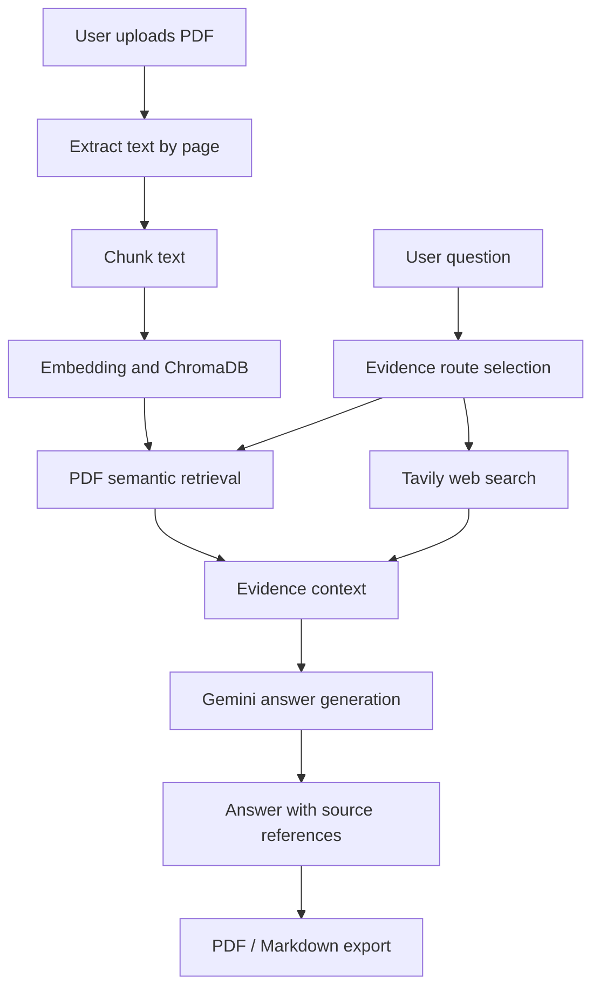

# PaperPilot — RAG Research Assistant

PaperPilot is an original student-oriented implementation of a research-paper assistant. Upload a PDF, ask a question, and the app retrieves relevant passages from the paper. When needed, it can also search the web and synthesize the available evidence with source references.

This implementation was written as a separate codebase. The uploaded reference project was used to understand the desired problem domain and workflow, not copied as its implementation.

## Features

- Upload and read text-based research-paper PDFs
- Split extracted PDF text into overlapping chunks
- Create embeddings and store them in ChromaDB
- Retrieve relevant passages using semantic similarity
- Route questions to PDF evidence, web search, or both
- Optional Tavily web search
- Gemini-powered evidence-grounded answers
- Show retrieved PDF passages and web sources
- Export answers to PDF or Markdown
- Store API keys in environment variables, not source code

## Architecture



## Requirements

- Python 3.10 or newer
- Gemini API key: https://aistudio.google.com/app/apikey
- Tavily API key for web search: https://app.tavily.com/

API quotas and pricing can change. Check each provider's current terms.

## Run locally in VS Code

### 1. Create a virtual environment

Windows PowerShell:

```powershell
py -m venv .venv
.venv\Scripts\Activate.ps1
python -m pip install --upgrade pip
pip install -r requirements.txt
```

### 2. Configure keys

Copy `.env.example` to `.env`, then add your actual API keys:

```env
GEMINI_API_KEY=your_actual_key
TAVILY_API_KEY=your_actual_key
GEMINI_MODEL=gemini-2.5-flash
```

Do not commit `.env` or share your API keys. You can disable web search in the sidebar if you only want to ask questions about the PDF.

### 3. Start the app

```powershell
streamlit run app.py
```

Open the local URL printed by Streamlit, usually `http://localhost:8501`.

## How the RAG workflow works

1. The user uploads a PDF.
2. The application extracts text page by page.
3. Text is split into overlapping chunks.
4. ChromaDB's default embedding function embeds and indexes the chunks.
5. The app asks Gemini whether the question needs PDF evidence, web evidence, or both.
6. Relevant PDF chunks are retrieved semantically and/or Tavily returns web results.
7. Gemini generates an answer from the supplied evidence and identifies PDF pages or web sources.
8. The user can inspect evidence and export the answer.

## Limitations

- Scanned PDFs without an embedded text layer may need OCR; OCR is not included.
- ChromaDB's default embedding function may download a model on first run.
- Some websites or search results may provide only snippets.
- The routing choice is heuristic and is not an independent verification system.
- Model-generated citations must be checked against the displayed sources before relying on important claims.
- This prototype has no user authentication or hosted database.

## Attribution and originality

This repository is a separate implementation inspired by the general problem of combining document RAG with web search. If you reuse any third-party code, assets, or text, review that project's license and retain required attribution. The project banner and app branding here are named PaperPilot.

## Security

Keep API keys in `.env`. The `.gitignore` file excludes it. Never publish API keys or private research papers unintentionally.
